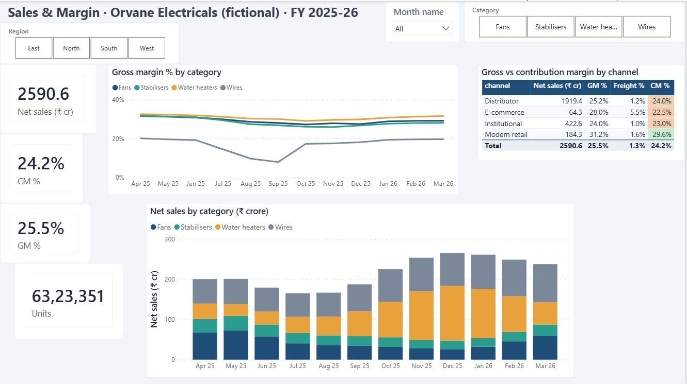
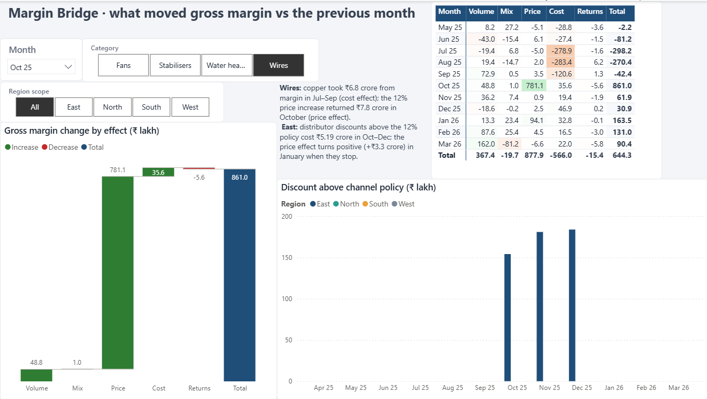
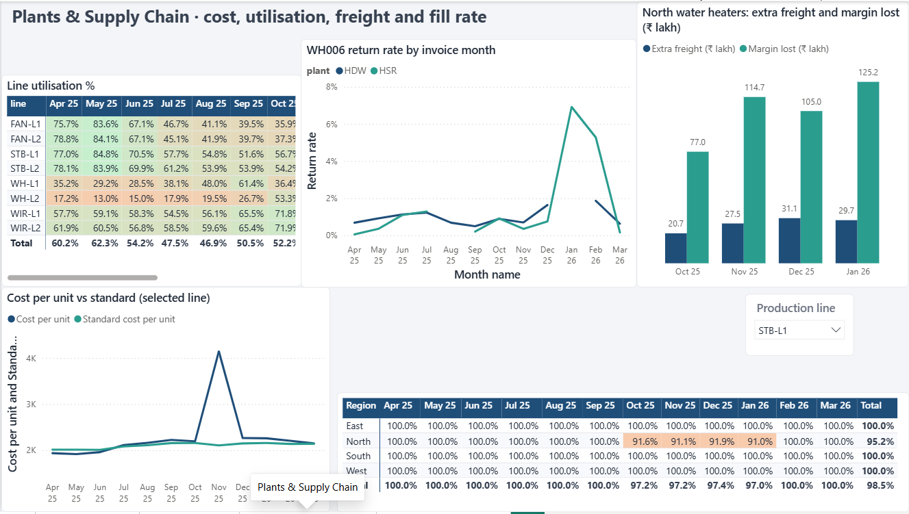
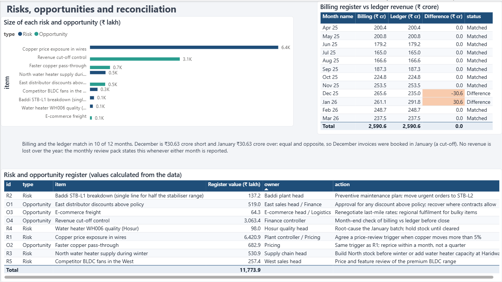
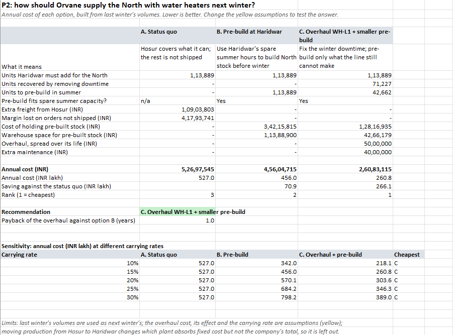

# Sales, Margin & Plant Cost Analytics

Analysis for the COO's office of a consumer electricals manufacturer: what moved sales and margin over the year, what each plant line really cost, where the supply chain lost money, and what to do about it.

> **The company and data are synthetic.** Orvane Electricals (fans, wires, water heaters, stabilisers; 3 plants, 4 regional warehouses, 400 customers) is invented. The data was generated with nine business problems planted in it, so the analysis can be checked against a known answer. Table layouts follow SAP extracts (VBRK/VBRP billing, AFKO production orders, CK11 standard costs, STO transfers, MB52 stock, FAGLFLEXT ledger); no real SAP system or company data was used.

**Period:** April 2025 – March 2026 · **Billing lines:** 156,494 after cleaning · **Net sales:** ₹2,590.6 crore

## What the analysis found

| Area | Finding | Value |
|---|---|---|
| Margin | Copper rose 18% (Jul–Sep) and wire prices stayed flat until October: wire gross margin fell from 20.1% to 8.0%, then recovered after a 12% price increase | ₹6.8 crore lost before the increase |
| Discounts | East distributors got discounts above the 12% policy in Oct–Dec; 20 accounts took 57% of it | ₹5.19 crore |
| Plants | Baddi stabiliser line STB-L1 was down 21 days in November: ₹4,143 per unit against a standard of ₹2,107 | 97% over standard |
| Supply chain | Haridwar could not meet North water heater demand in winter: 15,812 units not shipped and extra freight from Hosur | ₹4.22 crore margin + ₹1.09 crore freight |
| Channels | E-commerce has a 28.0% gross margin but 5.5% goes on freight, leaving the lowest contribution (22.5%) | ₹0.64 crore per point of freight |
| Quality | Water heater WH006 from Hosur: 6.9% of January and 5.3% of February invoices returned (normal 0.8%) | ₹0.98 crore returned |
| Competition | West premium fan share halved (18% → 9%) from August; sales field notes about cheaper competitor BLDC fans rose from about 20% to 54% of West notes | ₹2.6 crore margin |
| Reconciliation | Billing and ledger differ by ₹30.63 crore in December and the reverse in January: invoices booked in the wrong month, not lost | Explained cut-off |

**Recommendation (business case):** of three ways to supply the North next winter, overhauling the Haridwar line and pre-building only the remaining shortfall costs ₹2.61 crore a year, against ₹5.27 crore for doing nothing and ₹4.56 crore for pre-building everything. Payback about one year; the answer holds for carrying rates from 10% to 30%.

## What is in the repo

| Output | File | Built with |
|---|---|---|
| Leadership deck (8 slides) | [`deck/orvane_fy26_leadership_review.pdf`](deck/orvane_fy26_leadership_review.pdf) (.pptx alongside) | PowerPoint |
| Dashboard: sales & margin, margin bridge, plants & supply chain, risks & reconciliation | `powerbi/orvane_coo_office.pbix` | Power BI |
| Business case and copper what-if (live formulas, yellow assumption cells) | `excel/business_case.xlsx` | Excel |
| Monthly review packs, built only after billing reconciles to the ledger | `reviews/review_pack_<month>.xlsx` | Python + Excel |
| Ad hoc log: 10 COO-office questions, each with query, result and answer | [`docs/adhoc_log.md`](docs/adhoc_log.md) | SQL |
| Market brief: Orvane against Polycab, Havells, V-Guard and Crompton FY26 results, with sources | [`docs/market_brief.md`](docs/market_brief.md) | Public filings and earnings calls |
| Design, metric definitions, planted problems | [`docs/design.md`](docs/design.md) | |
| Data dictionary (46 tables and views) | [`docs/data_dictionary.md`](docs/data_dictionary.md) | Generated from the database |
| Monthly refresh SOP | [`docs/sop_monthly_refresh.md`](docs/sop_monthly_refresh.md) | |
| Templates: inputs register, analysis request, business case, deck | `templates/` | Excel, Markdown |

## Screenshots

**Sales & Margin**


**Margin Bridge** (October, wires: price +₹781.1 lakh)


**Plants & Supply Chain**


**Risks & Reconciliation**


**Business case (Excel)**


## How it works

```
data/raw (SAP-style extracts, with errors)  →  src/clean_data.py (5 rules, each counted)
   →  PostgreSQL schemas ref, sd, pp, mm, fi, inp  →  sql/ views in schema rpt (every metric defined once)
   →  Excel business case · Power BI · review pack · ad hoc log · tests
```

- **Cleaning:** dates in two formats, old material codes, wire quantities in metres, duplicate lines and missing regions are fixed by documented rules; every row changed is logged in `etl.cleaning_log`. Duplicates are removed last, after the other rules have made them identical.
- **Margin bridge:** each month's change in gross margin split into volume, mix, price, cost and returns. The five add up exactly to the change.
- **Reconciliation:** billing is matched to ledger revenue every month. The review pack script stops if a difference is not explained by a cut-off.
- **Field notes:** 1,200 sales visit notes were tagged into 7 themes with a local language model (qwen3:4b via Ollama). Accuracy: 99.2% against the generator's answer key and 39 of 40 in a hand check. The notes are synthetic and cleaner than real ones, so real accuracy would be lower.
- **Tests:** 34 pytest tests in four groups: planted findings are found, data integrity (including no line above 100% utilisation), an independent pandas recalculation that must match the SQL views, and the review pack refusing an unexplained difference.

## How to run it

Needs Python 3.11+, PostgreSQL and (only for re-tagging field notes) Ollama with `qwen3:4b`.

```
pip install -r requirements.txt
python src/generate_data.py                      # writes data/raw and the answer key
python src/clean_data.py                         # writes data/clean and the cleaning log
python src/load_data.py --port 5432              # creates database orvane, loads tables, builds views
python -m pytest -s -v tests --port 5432
python src/show.py margin --port 5432            # topics: sales, margin, bridge, plants, supply, recon, register, notes
python src/build_review_pack.py --month 2026-01 --port 5432
python src/export_reporting.py --port 5432 && python src/build_business_case.py
python src/build_adhoc_log.py --port 5432
```

The PostgreSQL password is asked for when needed (or read from `PGPASSWORD`) and never stored. The full monthly routine is in [`docs/sop_monthly_refresh.md`](docs/sop_monthly_refresh.md).

## Limits

- Synthetic data: the project shows the analysis, not experience inside a manufacturing company or with real teams. Inputs from sales, plants, supply chain and finance are simulated in the inputs register.
- The data does not model weather, regulation changes (such as fan star ratings) or receivables, all of which mattered in the real industry in FY26 (see the market brief).

Aditya Ranjan · [LinkedIn](https://www.linkedin.com/in/aditya-ranjan-data) · [GitHub](https://github.com/beingbrute)
